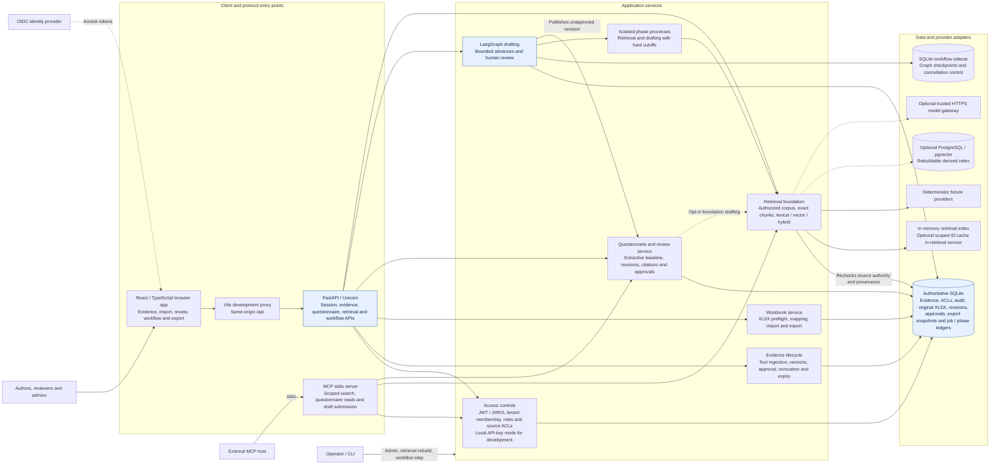
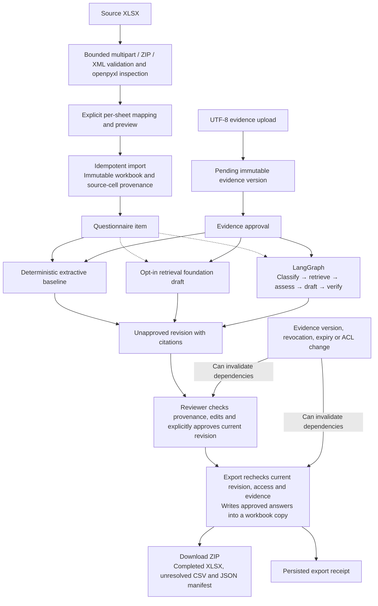
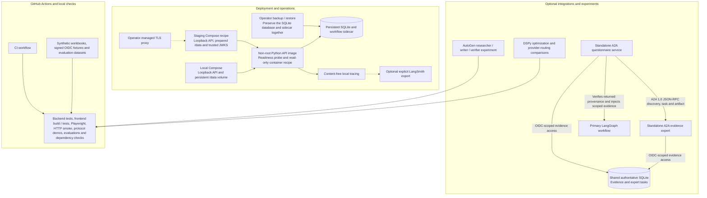

# EvidenceDesk system architecture

The diagrams show the architecture implemented in this checkout. Dashed arrows indicate optional integrations or deployment-specific paths.

## System overview

## Workbook and evidence lifecycle

## Optional protocols, deployment and verification

The staging recipe covers the API. The frontend build expects a same-origin production `/api` route, whose hosting remains operator work. The repository records local synthetic validation and lists live IdP, paid providers, and Docker/staging rollback among the unverified external gates.

Repository references: [FastAPI entry point](../app/main.py), [frontend](FRONTEND.md), [access](ACCESS.md), [workbooks](WORKBOOKS.md), [retrieval](RETRIEVAL.md), [workflows](WORKFLOWS.md), [MCP](MCP.md), [A2A](A2A.md), [AutoGen](AUTOGEN.md), [operations](OPERATIONS.md), [CI](../.github/workflows/ci.yml).

